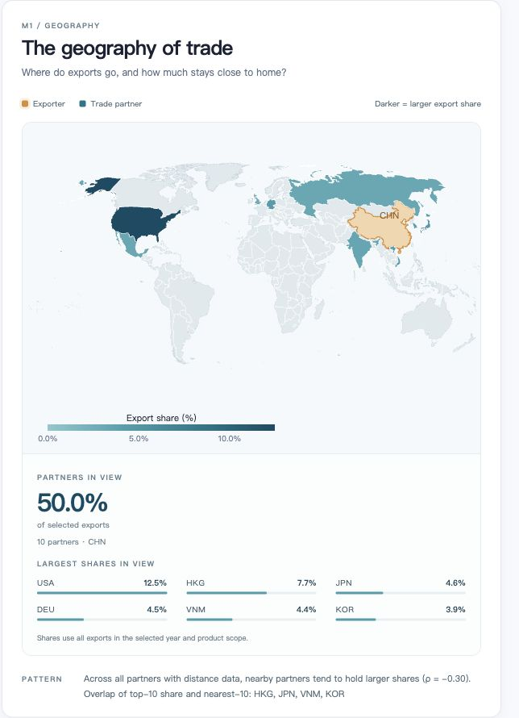
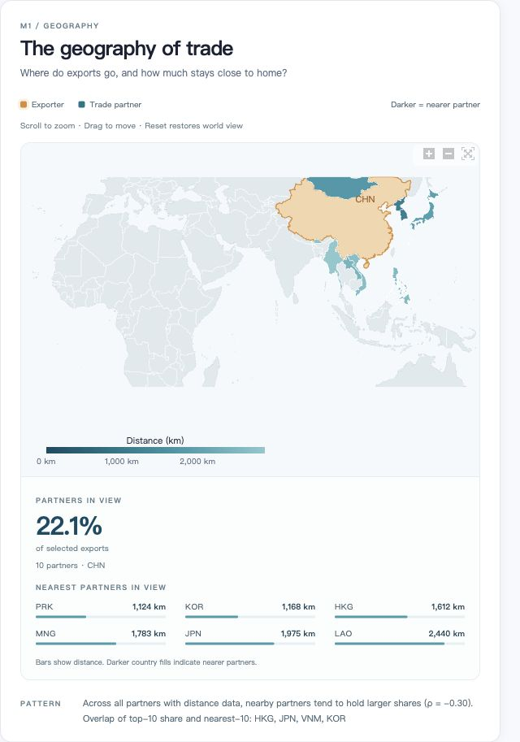

# M1｜地理距离与贸易伙伴分布

更新日期：2026-11-09
项目：COMP7507 Visualization & Visual Analytics · Group 7  
模块：M1 Geography

## 1. 模块目标

M1 围绕“地理位置更近的伙伴，是否通常占有更大的出口份额？”展开探索。用户选择年份、出口国和商品范围后，通过国家区域填色地图观察伙伴分布，再结合份额／距离排行、指标卡片和对比表判断地理接近程度与贸易份额之间的关系。

模块检验的是描述性关联。地图和相关系数不用于证明距离对贸易的因果影响，也不构成控制其他因素后的贸易引力模型。

当前已实现：

- 按出口份额或距离对伙伴国家区域填色。
- 切换份额前十、最近十个和出口额前四十个伙伴。
- 地图悬浮详情、滚轮缩放、拖动、放大／缩小按钮与一键重置。
- 地图优先的浅色布局、完整展示范围的可点击伙伴列表，以及份额、距离和合计份额。
- 地图、伙伴列表和散点图联动；地图内滚轮缩放不会带动页面滚动。
- 散点图增加距离分组中位数、组内四分位差异带和主要伙伴标签；界面保持全英文。
- 伙伴数量、距离覆盖率、贸易加权距离和 Spearman 相关系数。
- 主要贸易伙伴与最近伙伴对比表，以及“假设—证据—结论”说明。

## 2. 启动与使用

在项目根目录安装依赖并启动应用：

```bash
pip install -r requirements.txt
python app.py
```

访问 `http://127.0.0.1:8050`，在导航栏选择 **M1 Geography**。`8050` 是 `app.py` 的默认端口。

### 2.1 筛选控件

| 控件 | 可选范围 | 默认值 | 作用 |
| --- | --- | --- | --- |
| 年份 | 1995–2024 | 2023 | 选择贸易数据年份 |
| 出口国 | 中国、德国、荷兰、意大利、墨西哥、美国；贸易伙伴不限于这六个国家 | China（CHN） | 固定出口方向，查看其目的地伙伴 |
| 商品 | All products 或一个 HS2 商品章 | All products | 切换全部商品或单一商品范围 |
| 距离指标 | Simple distance | Simple distance | 使用 GeoDist 的 `dist` 列；其他距离列保留在分析层 |
| 显示范围 | Top 10 by share / Nearest 10 / Top 40 partners | Top 10 by share | 控制地图和侧栏展示的伙伴集合 |

商品列表沿用项目商品字典，当前不提供 HS2 的 `77` 和 `99`。模块使用自己的筛选控件，不自动改变其他模块的选择。

### 2.2 推荐探索步骤

1. 选择出口国、年份和商品范围，以 **Top 10 by share** 查看主要出口市场及其地理分布。
2. 切换 **Nearest 10**，比较地理上最近的伙伴与主要市场是否重合。
3. 查看下方对比表中的 `Top 10 share`、`Nearest 10` 标记，定位同时属于两组的伙伴。
4. 结合覆盖率与 Spearman ρ 判断关联，再更换年份、商品或距离指标，检查结果是否稳定。
5. 对密集地区放大查看，悬浮读取具体出口额、份额和距离。

## 3. 地图与页面的阅读方式

### 3.1 国家区域填色

地图采用 Natural Earth 投影，伙伴使用连续青色，出口国使用橙色。伙伴以国家区域填色展示，不使用圆点编码贸易量。

| 显示模式 | 伙伴选择规则 | 区域颜色含义 | 侧栏排序及条形含义 |
| --- | --- | --- | --- |
| Top 10 by share | 有效伙伴中份额排名前十 | 出口份额越大，颜色越深 | 按份额降序；条形表示份额 |
| Nearest 10 | 有效伙伴中距离排名前十 | 距离越近，颜色越深 | 按距离升序；条形表示出口份额，右侧同时列出份额与距离（km） |
| Top 40 partners | 有效伙伴中出口额最高的四十个 | 出口份额越大，颜色越深 | 按份额降序；条形表示份额 |

有效伙伴需要有正的距离记录、非缺失且大于零的出口份额。前十模式采用排名筛选，边界出现并列时，实际展示数量可能超过十个；不足时则显示全部符合条件的伙伴。

色阶下限为零，上限为当前展示集合的最大份额或最大距离。**切换国家、商品或显示范围后，颜色会重新定标，跨视图比较应读取数值，而不能只比较深浅。** 距离模式反转色阶，使较小的公里数对应较深的青色。

灰色表示未在当前地图中着色，可能是未进入显示范围、缺少有效距离或没有可展示的贸易记录，不能直接解读为贸易额为零。小面积区域在世界视图中不易辨认时，可放大并结合表格查看。

### 3.2 缩放、拖动与悬浮

- 在地图区域使用滚轮或触控板缩放，页面保持不动；移到地图外可正常滚动页面。也可点击右上角的 **Zoom in／Zoom out**。
- 拖动地图调整查看位置；点击 **Reset** 恢复世界视图。
- 悬浮在有数据的伙伴区域，显示伙伴名称、代码、出口份额、美元出口额和距离。
- 同一出口国下切换筛选时保存地图视角；切换出口国时恢复初始视角。

桌面布局将地图与排行并排呈现；较窄屏幕下排行移到地图下方，手机端压缩地图高度并将排行排成两列。

### 3.3 侧栏与对比表

侧栏大数字是**当前展示伙伴的合计出口份额**，分母仍为所选年份、出口国和商品范围内的全部出口额。列表展示当前范围内的全部伙伴，可滚动查看并点击选择。

对比表独立于地图显示模式，展示以下三组有效伙伴的并集：份额前十、距离最近十个、出口额前四十个。表中给出距离、出口额、份额、两种排名及重合标记，每页十行。地图模式切换不会将该表缩减为当前地图中的伙伴。

### 3.4 散点图与距离分组

地图位于筛选和指标下方，散点图位于地图之后。散点保留完整的正份额、有效距离伙伴样本，不随地图的 Top-N 显示范围改变。金线将伙伴按距离分成最多五个近似等量组，并连接每组出口份额的中位数；浅色带表示组内第 25–75 百分位的差异，不是置信区间。样本不足或距离缺少变化时不绘制分组趋势。主要伙伴使用代码标注，图内同时展示最近组与最远组的中位数。

分组使用每个伙伴同等权重，不能解读为某距离组的出口总额，也不能用于因果推断。原始散点、份额分母和 Spearman 统计口径保持不变。

## 4. 数据来源与文件

贸易数据使用 **CEPII BACI HS92 V202601，1995–2024 年**；地理距离使用 **CEPII GeoDist**。M1 不依赖 CHELEM 的宏观经济指标。

运行时优先读取 `data/processed/` 下的紧凑分析表：

| 文件 | 关键字段 | 用途 |
| --- | --- | --- |
| `country_pair_year.parquet` | `year, exporter, importer, value` | 全部商品的双边年度出口额 |
| `country_pair_hs2_year.parquet` | `year, exporter, importer, hs2, value` | 单个 HS2 商品章的双边年度出口额 |
| `geodist.parquet` | `iso_o, iso_d, dist, distw, distcap, contig, comlang_off` | 出口国与伙伴的距离及辅助关系字段 |
| `country_meta.parquet` | `iso3, name, region` | 经济体名称、地区与选择列表 |
| `country_locations.csv` | `iso3, lat, lon` | 出口国文字标签的代表位置 |

`country_locations.csv` 包含 225 个经济体的 GeoDist 代表城市坐标，提取时优先选择 `maincity`，再以 `cap` 排序并按 ISO3 去重。该文件只负责文字标签位置；国家区域填色由 Plotly 地图边界提供，双边距离直接来自 GeoDist，不由标签坐标临时计算。当前地图设置 `resolution=50`；缺少坐标文件时，标签回退到 ISO 定位。

`value` 的存储单位为**千美元**。对比表 `Exports (k USD)` 沿用该单位；地图悬浮卡先乘以 1000 转换为美元，再以 K／M／B／T 缩写显示。距离单位为 **km**，份额单位为 **%**。

原始数据目录和环境变量配置见 [数据准备说明](DATA.md)。需要重新生成分析表时，在项目根目录运行：

```bash
python scripts/build_analytics.py
```

数据加载器在对应 parquet 缺失时返回确定性的演示数据，M1 会提示当前使用演示数据。正式分析前应检查所需分析表是否齐全；仅修改 `DATA_READY` 标记不会生成数据文件。

## 5. 指标计算口径

### 5.1 出口方向与份额分母

首先按年份、出口国和商品范围筛选贸易记录，剔除出口国与进口国相同的记录，再按目的地伙伴汇总。只分析从所选出口国流向伙伴的出口，不将反方向贸易额相加。

```text
伙伴出口份额（%）
  = 对该伙伴的出口额
    ÷ 所选年份、出口国和商品范围内对全部伙伴的出口额
    × 100
```

切换显示前十、最近十个或前四十个伙伴，只改变展示集合，不重新计算份额分母。缺少距离的贸易记录仍保留在份额分母中，但不进入需要有效距离的地图、排名和距离统计。

### 5.2 距离指标

| 界面名称 | GeoDist 字段 | 说明 |
| --- | --- | --- |
| Weighted distance | `distw` | GeoDist 提供的加权距离列，默认选项 |
| Capital distance | `distcap` | GeoDist 提供的首都距离列 |
| Simple distance | `dist` | GeoDist 提供的简单距离列 |

若所选距离列不存在，程序按 `dist → distw → distcap` 顺序寻找可用列，并在界面提示实际采用的指标。距离缺失或不大于零时，记录不作为有效距离样本。

### 5.3 指标卡片

| 指标 | 计算范围与含义 |
| --- | --- |
| Partners | 所选贸易范围内的伙伴数量，包含没有距离记录的伙伴 |
| Distance coverage | 有有效距离的伙伴数 ÷ 全部伙伴数；按伙伴数量计算，不是按贸易额计算 |
| Weighted distance | 在有效样本中，以出口额为权重计算平均距离 |
| Spearman ρ | 在有效距离且份额非缺失的全部样本中，计算距离与份额的秩相关系数 |

```text
贸易加权平均距离
  = Σ（伙伴出口额 × 对该伙伴的距离）
    ÷ Σ（有有效距离伙伴的出口额）
```

“Weighted distance”在两个位置有不同含义：筛选框选择的是 GeoDist 的 `distw` 列；指标卡计算的是所选距离指标上的贸易额加权平均值。即使选择 `dist` 或 `distcap`，该指标卡仍然会进行出口额加权。

Spearman ρ 使用距离与份额各自的排名计算。实现先对距离取对数再排名；对正距离而言，这不会改变排序。ρ 越负，表示距离越近的伙伴通常有更大份额；ρ 接近零表示单调关联较弱，不能据此断言不存在其他关系。

相关系数使用完整有效样本，**不是只对当前地图展示的前十或前四十个伙伴计算**。界面的 `ρ ≤ -0.3` 与 `-0.3 < ρ < 0` 是自动生成描述文字的规则，不是显著性检验阈值。样本过少或覆盖率不足时，结论区提示证据不足。

## 6. 实现结构

| 文件 | 职责 |
| --- | --- |
| [`src/modules/m1_geography.py`](../src/modules/m1_geography.py) | M1 布局、地图、排行、对比表、动态结论和回调 |
| [`src/analytics/geography.py`](../src/analytics/geography.py) | 贸易聚合、距离关联、份额、排名相关与统计计算 |
| [`src/data_loader.py`](../src/data_loader.py) | 缓存读取分析表，缺少真实运行表时明确报错 |
| [`assets/m1.css`](../assets/m1.css) | M1 配色、地图卡片、排行与响应式布局 |
| [`assets/m1.js`](../assets/m1.js) | 浏览器本地选择、高亮和轻量视图状态 |
| [`assets/m1_wheel.js`](../assets/m1_wheel.js) | 地图范围内消费滚轮事件，保留 Plotly 缩放与地图外页面滚动 |
| [`src/geo_topology.py`](../src/geo_topology.py) | 简化共享边界并校验多边形方向，保留全部地理要素及小地区 |
| [`src/layout.py`](../src/layout.py) | 页面导航与图表尺寸更新；允许 M1 地图保留交互 |
| [`tests/test_m1_geography.py`](../tests/test_m1_geography.py) | 分母、距离、空数据、区域填色与地图视角等测试 |

核心计算链路：

1. `trade_by_partner()` 筛选并按目的地汇总贸易额。
2. `attach_geography()` 左连接所选出口国的 GeoDist 记录。
3. `partner_frame()` 计算完整范围内的份额，并补充名称与地区。
4. `analyze()` 返回伙伴分析表、统计摘要及辅助分析结果。
5. 视图层分别生成地图、侧栏、对比表和结论文字。

所有组件 ID 使用 `M1-` 前缀。回调先执行 `guard_active()`，隐藏模块不重新计算；M1 不写入全局筛选状态。地图通过 `graph-interactive` 跳过页面外层的静态图表交互锁定，同时继续响应导航后的尺寸更新。

地图视角以出口国作为 `uirevision` 标识，并通过 `relayoutData` 与前一张图的布局保存缩放、中心和旋转状态。

分析层还包含例外伙伴识别与对数趋势计算辅助函数；当前页面没有单独绘制这些结果，不应将其描述为已展示的功能。

## 7. 当前数据示例

以下结果于 2026-11-04 使用本地真实分析表复算，选择为 **2024 年、CHN、All products、distw**：

| 项目 | 结果 |
| --- | --- |
| 贸易伙伴数量 | 208 |
| 有效距离伙伴数量 | 197 |
| 距离覆盖率 | 94.71% |
| 贸易加权平均距离 | 约 7,100 km |
| Spearman ρ | -0.3023 |
| 最大份额伙伴 | USA，约 12.50% |
| 地图份额前十伙伴合计份额 | 约 49.96% |
| 地图最近十个伙伴合计份额 | 约 22.07% |
| 地图出口额前四十个伙伴合计份额 | 约 84.47% |
| 份额前十与最近十个的重合伙伴 | HKG、JPN、VNM、KOR |

该示例显示一定的负向关联，但仅适用于上述数据版本和筛选条件。更换年份、商品范围、距离指标或数据版本后，应重新读取结果。

## 8. 验证与界面截图

2026-11-09：完整测试共 113 项通过。浏览器验证地图置顶、地图内滚轮缩放时页面不动、地图外正常滚动、伙伴联动与全英文界面。简化边界将顶点从 122,526 减少至 31,128，全部 241 个地理要素保留；该比例不代表帧率提升比例。

最近一轮全项目测试为 **29 项通过**，包括 M1 的 14 项测试及其他现有模块测试。M1 已覆盖：份额分母、商品筛选、距离指标回退、缺失距离、空结果、排名相关、国家区域填色、距离色阶方向、默认出口国，以及地图视角保存与切换出口国后的重置逻辑。

浏览器中已实际验证放大、缩小、滚轮缩放、拖动、Reset，以及切换显示模式后保留当前视角。

```bash
# 只运行 M1 测试
python -m unittest discover -s tests -p 'test_m1_geography.py' -v

# 运行全部现有测试
python -m unittest discover -s tests -v
```

份额填色示例：



缩放与距离模式示例：



截图对应功能验证时的界面状态，不代表所有控件组合或所有数据年份。补充的简版地图设计说明见 [M1 map design](M1_map_design.md)。
